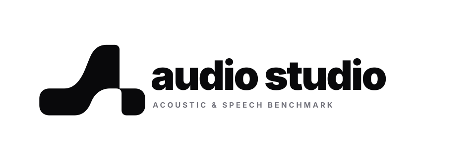
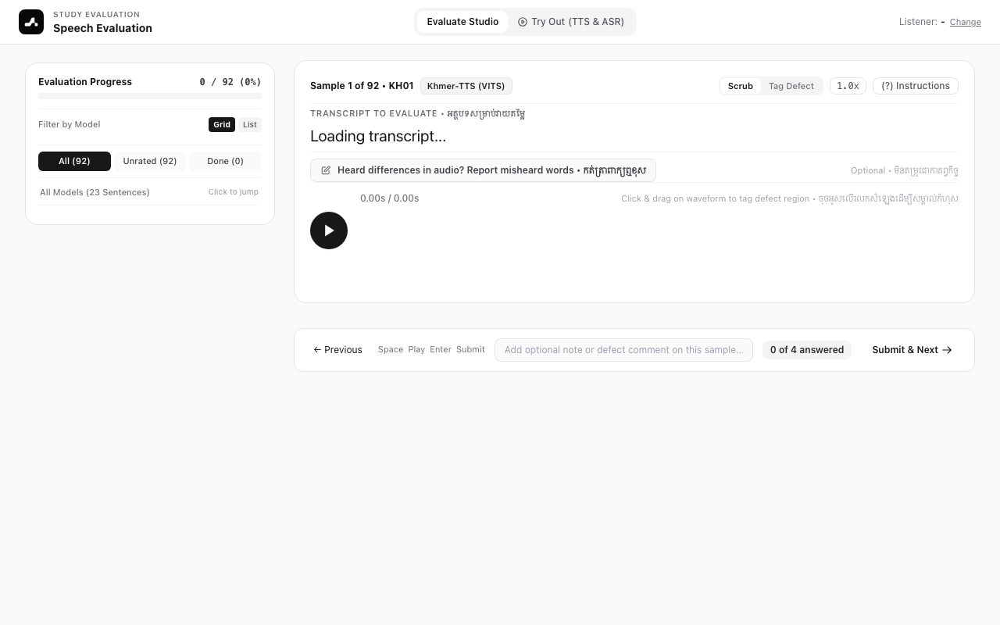
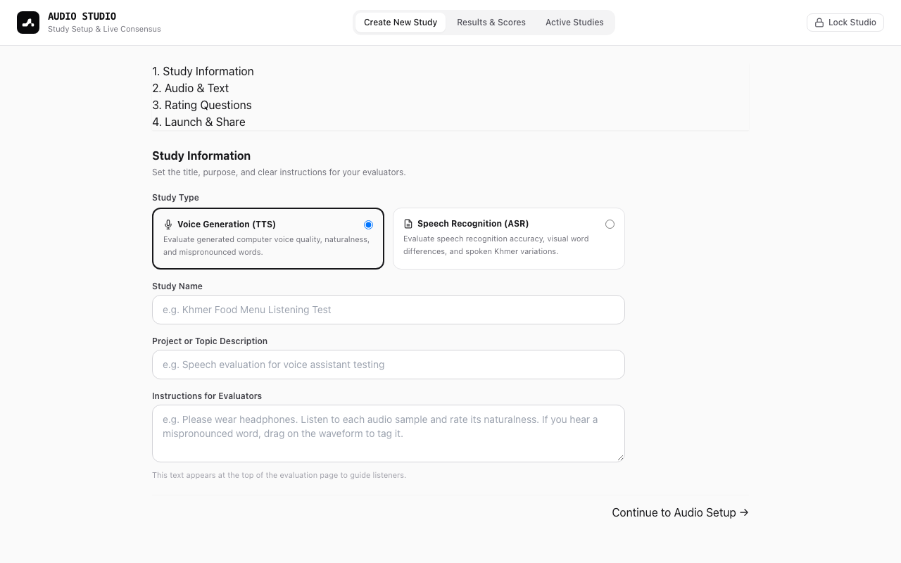
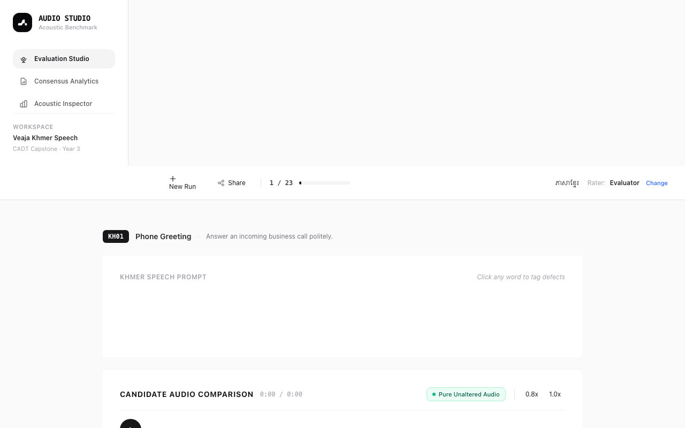

<p align="center">
  <picture>
    <source media="(prefers-color-scheme: dark)" srcset="docs/images/logo_banner_dark.svg">
    <source media="(prefers-color-scheme: light)" srcset="docs/images/logo_banner_light.svg">
    
  </picture>
</p>

<p align="center">
  A clean, self-contained tool to test, evaluate, and compare speech synthesis (TTS) and speech recognition (ASR) models.
</p>

---

## What is Audio Studio?

When building or testing speech models, numbers like training loss or Word Error Rate (WER) do not tell you the full story. A model can have great numbers on paper but still sound robotic, stumble on words, or introduce strange pauses.

Real people need to listen to the audio to judge naturalness, pronunciation, and voice quality.

**Audio Studio** is a lightweight web application that makes human audio evaluation easy:
1. **Admins** can create listening studies, upload audio samples, choose rating rubrics, and manage active tests.
2. **Listeners** get a clean, focused webpage where they can listen to samples, rate them on a 1–5 scale, and highlight specific defects right on the waveform.
3. **Teams** get instant consensus scores (Mean Opinion Score / MOS) and one-click CSV export with zero complicated setup.

---

## Screenshots

### 1. Evaluator Listening Portal
*A distraction-free interface where listeners rate audio quality and highlight mispronounced words or acoustic defects on the waveform.*



### 2. Admin Study Creator
*A step-by-step wizard to create new evaluation studies, set target models, upload test audio, and customize rating questions.*



### 3. Acoustic Inspector & Comparison Studio
*Direct side-by-side comparison across different acoustic models, with playback speed controls and detailed sample inspection.*



---

## Key Features

- **Zero External Dependencies**: Built entirely with Python's built-in standard library (`http.server` and `sqlite3`). You do not need to install complex web frameworks or package managers.
- **Transparent Rater Identity & Draft Resilience**: Listeners confirm or change their display identity upon returning, with automatic local draft saving per study/rater and a dedicated draft reset action.
- **Waveform Defect Tagging & Interactive Inspector**: Listeners drag directly across the audio waveform to flag specific acoustic and pronunciation defects. Administrators can inspect evaluations in an interactive DSP canvas with click-to-seek defect spans and variable playback speeds (1.0x, 0.8x).
- **Comprehensive Results & Moderation Dashboard**: Admin Results & Scores provides 4 dedicated views:
  1. **Overview**: Executive MOS metrics, dynamic cross-scale score cards, ASR WER/CER stats, and word-level defect heatmap.
  2. **All Evaluations**: Filterable ledger with modal DSP waveform inspection and single-evaluation deletion.
  3. **Raters & Progress**: Evaluator leaderboard, page coverage modal (All / Evaluated / Remaining), inline rater rename, and scoped/global deletion.
  4. **Defects & Transcripts**: Acoustic defect catalog and rater transcription analysis.
- **Admin Security & Scoped Export**: Study administration, rater moderation, and consensus analytics are protected behind an admin PIN. Filtered CSV exports can be scoped by campaign, model, or evaluator.
- **Pre-Loaded Sample Benchmark**: Includes an out-of-the-box benchmark comparing 4 speech synthesis models across conversational test sentences so you can test the studio immediately after cloning.

---

## Quick Start

### Requirements
- **Python 3.9 or higher** (macOS, Linux, or Windows).
- No third-party packages or virtual environment needed.

### Running the Studio

1. **Clone the repository**:
   ```bash
   git clone https://github.com/SvayMonirath/Audio-Studio.git
   cd Audio-Studio
   ```

2. **Start the server**:
   ```bash
   python3 run_server.py
   ```
   *(Or on macOS/Linux: `./run_studio.sh`)*

3. **Open in your browser**:
   - **Main Studio**: [http://localhost:8000](http://localhost:8000)
   - **Listening Portal (for raters)**: [http://localhost:8000/eval.html](http://localhost:8000/eval.html)
   - **Admin Console**: [http://localhost:8000/admin.html](http://localhost:8000/admin.html) *(Default PIN: `2026`)*

### Custom Configuration

You can customize the host, port, or admin PINs using command-line arguments or environment variables:

```bash
# Run on a custom port
python3 run_server.py --port 9000

# Set custom admin access PINs
ADMIN_PINS="2026,5588,mysecretpin" python3 run_server.py
```

---

## Application Pages

| URL Route | Purpose | Access |
|---|---|---|
| `http://localhost:8000/` | Main studio workspace and model inspector | Open |
| `http://localhost:8000/eval.html` | Listening portal for human evaluators (draft persistence, sequence navigation) | Open (No PIN needed) |
| `http://localhost:8000/admin.html` | Study creation wizard, rater moderation, DSP waveform inspector, and analytics | Protected (Admin PIN) |

---

## REST API Overview

All API endpoints are hosted by `run_server.py` using Python standard library:

### Evaluator Endpoints (Unauthenticated)
- `GET /api/campaigns` — List active evaluation campaigns/studies.
- `GET /api/campaigns?id=<id>` — Fetch campaign details, items, rubrics, and model list.
- `POST /api/raters` — Register or identify an evaluator (`{ name, campaign_id }`).
- `POST /api/evaluations` — Submit an evaluation record with score breakdown and timestamped defect tags (`dt-{ts}-{idx}-{uuid}`).

### Admin Endpoints (Require Admin PIN via `X-Admin-PIN` header)
- `GET /api/admin/summary?campaign_id=<id>` — Comprehensive metrics: study metadata, score distributions, ASR accuracy, word defect heatmap, and rater progress.
- `GET /api/evaluations?campaign_id=<id>` — Retrieve full evaluation ledger for audit and inspection.
- `DELETE /api/evaluations?id=<id>` — Delete a specific evaluation record.
- `GET /api/admin/export.csv?campaign_id=<id>&model_id=<m>&rater_id=<r>` — Scoped CSV export of response records and tagged defect spans.
- `POST /api/admin/raters/rename` — Rename a rater display name globally across evaluations (`{ rater_id, new_name }`).
- `DELETE /api/raters?id=<id>&campaign_id=<cid>` — Remove a rater's evaluations from a study (scoped) or delete the rater record entirely (global).
- `POST /api/campaigns` — Create a new study campaign with custom rubrics and audio items.
- `DELETE /api/campaigns?id=<id>` — Delete a study campaign and its associated evaluation records.

---

## Running the Automated Tests

Audio Studio includes an automated test suite verifying database integrity, audio streaming, evaluator submission, and admin endpoints.

To run the tests:

```bash
python3 -m unittest discover -s tests -v
```

All tests run locally in under 2 seconds without external network calls.

---

## Project Structure

```text
Audio-Studio/
├── run_server.py        # HTTP server and REST API (zero dependencies)
├── database.py          # SQLite schema, migrations, and seed data
├── run_studio.sh        # Startup shell script
├── public/              # Web application frontend
│   ├── index.html       # Main studio and acoustic inspector
│   ├── admin.html       # Study creation wizard and analytics
│   ├── eval.html        # Listening portal for raters
│   ├── css/             # Stylesheets
│   ├── js/              # Client-side audio player and UI logic
│   ├── assets/brand/    # Audio Studio vector marks and icons
│   └── data/            # Pre-loaded benchmark definitions and taxonomies
├── audio/               # Sample audio files for candidate models
├── tests/               # Automated unit and API test suite
└── docs/images/         # Documentation screenshots and brand assets
```
